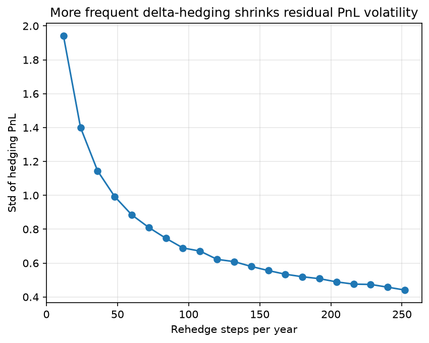
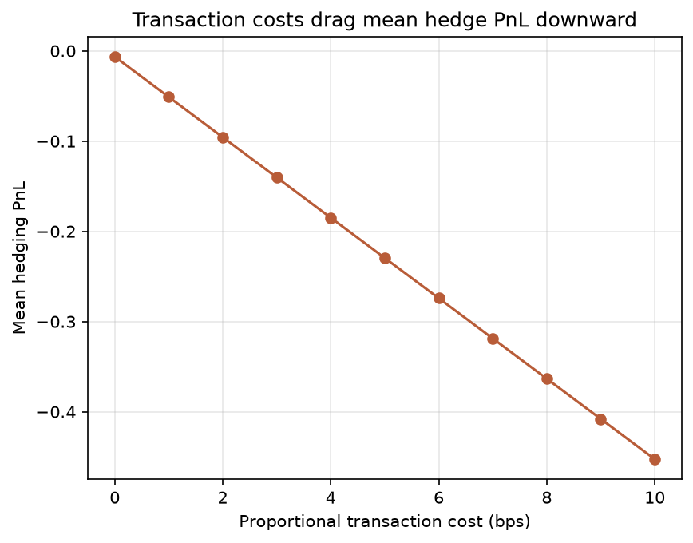
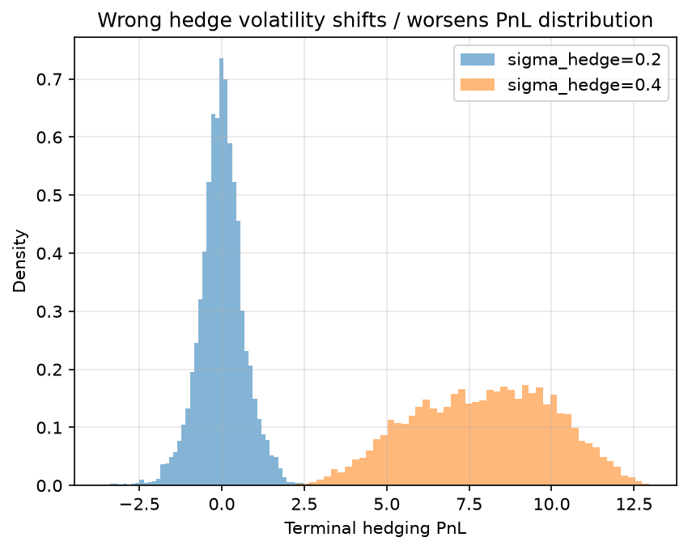
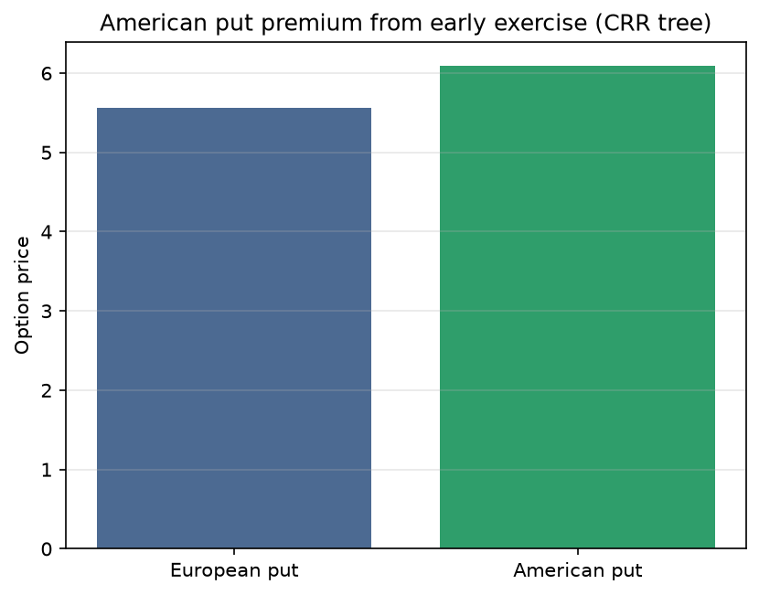

# Options Pricing & Delta-Hedging Lab

This is a derivatives lab written from scratch in Python. It prices European and American options with Black–Scholes and the Cox–Ross–Rubinstein tree, computes analytic Greeks, and runs a Monte Carlo simulation of discrete delta-hedging for a short call.

The question is not whether we can predict tomorrow's price. It is this:

> If we sell a call and hedge it with delta, what does the PnL distribution look like once rebalancing is discrete, trading costs exist and the volatility input is wrong, and how heavy are its tails in terms of VaR and Expected Shortfall?

## Motivation

I built this project to learn the foundations of quantitative finance: risk-neutral pricing, Greeks as the language of risk, and hedging as replication rather than directional betting. Every pricer is implemented by hand instead of relying on a library, and the test suite checks put–call parity, tree convergence to Black–Scholes and the Greeks against finite differences.

## Features

- European call and put payoffs
- Risk-neutral geometric Brownian motion (GBM) path simulation
- Black–Scholes prices based on $d_1$ and $d_2$
- Analytic Greeks: delta, gamma, vega, theta and rho
- CRR binomial tree for European and American options
- Monte Carlo delta-hedging with transaction costs and volatility misspecification
- VaR and Expected Shortfall of the hedge PnL
- One script that reproduces every experiment and figure

## Repository structure

```text
src/
  payoffs.py          # call and put terminal payoffs
  gbm.py              # GBM path simulator
  black_scholes.py    # Black–Scholes prices
  greeks.py           # analytic Greeks
  binomial.py         # CRR European and American
  hedging.py          # discrete delta-hedge simulation
  risk.py             # VaR and ES helpers
scripts/
  run_experiments.py  # experiments and plots
tests/                # pytest suite
reports/figures/      # output plots
```

## Setup

The code needs Python 3.11 or newer and was developed on Python 3.12 under Windows.

```powershell
python -m venv .venv
.\.venv\Scripts\Activate.ps1
python -m pip install -r requirements.txt
```

Always call `python -m pip` and `python -m pytest`, so that the interpreter of the active virtual environment is used. A bare `pip` may point to a global Anaconda installation.

## Tests

```powershell
python -m pytest -q
```

## Experiments

```powershell
python scripts/run_experiments.py
```

Unless stated otherwise, the experiments use $S_0 = 100$, $K = 100$, $r = 5$, $T = 1$ year, 5000 paths and seed 42.

## Methods

**1. Payoffs.** At expiry a European call and a put pay

$$
(S_T - K)^+ = \max(S_T - K,\, 0),
\qquad
(K - S_T)^+ = \max(K - S_T,\, 0).
$$

Pricing, hedging and early exercise all build on these terminal payoffs.

**2. GBM.** Stock paths follow the risk-neutral dynamics

$$
\mathrm{d}S_t = r S_t\,\mathrm{d}t + \sigma S_t\,\mathrm{d}W_t
$$

and are simulated with the exact lognormal step. This is the engine of the hedging experiments and not a model for forecasting returns.

**3. Black–Scholes.** The price of a European option is the discounted risk-neutral expected payoff. Under GBM it has a closed form in terms of

$$
d_1 = \frac{\ln(S_0/K) + \left(r + \tfrac12\sigma^2\right)T}{\sigma\sqrt{T}},
\qquad
d_2 = d_1 - \sigma\sqrt{T},
$$

namely

$$
C = S_0\, N(d_1) - K e^{-rT}\, N(d_2),
\qquad
P = K e^{-rT}\, N(-d_2) - S_0\, N(-d_1).
$$

Put–call parity, $C - P = S_0 - K e^{-rT}$, serves as a sanity check.

**4. Greeks.** The call delta

$$
\Delta_{\mathrm{call}} = N(d_1)
$$

is the local hedge ratio. Gamma, vega, theta and rho follow from differentiating the Black–Scholes price, and every Greek is tested against a finite-difference bump of the price.

**5. CRR European.** The recombining binomial tree uses the up factor, down factor and risk-neutral probability

$$
u = e^{\sigma\sqrt{\Delta t}},
\qquad
d = \frac{1}{u},
\qquad
p^* = \frac{e^{r\Delta t} - d}{u - d},
$$

and the price follows from backward induction. As the number of steps $N$ grows, the tree converges to Black–Scholes.

**6. CRR American.** The tree is the same, but at every node the holder may exercise early, so the node value becomes

$$
V = \max\left(V_{\mathrm{exercise}},\, V_{\mathrm{continuation}}\right).
$$

This is exactly what the closed-form Black–Scholes price cannot capture, and it matters for puts when $r > 0$.

**7. Delta-hedging.** We sell one European call and receive the Black–Scholes premium computed with the hedge volatility $\sigma_{\mathrm{hedge}}$. We then hold $\Delta$ shares of stock and rebalance on a fixed time grid, while the cash account earns the rate $r$. The stock paths are generated with the realized volatility $\sigma_{\mathrm{real}}$, which may differ from $\sigma_{\mathrm{hedge}}$. At maturity we pay the call payoff and sell the remaining shares. The initial position and the hedge ratio are

$$
\Pi_0 = C^{\mathrm{BS}}(S_0;\,\sigma_{\mathrm{hedge}}) - \Delta_0 S_0,
\qquad
\Delta_t = N\left(d_1(S_t,\,\tau_t;\,\sigma_{\mathrm{hedge}})\right),
$$

where $\tau_t$ is the time left to maturity. The terminal PnL is what remains in cash after financing, rebalancing costs and the final payoff $(S_T - K)^+$.

**8. VaR and ES.** On the Monte Carlo sample of terminal PnLs we define the loss $L = -\mathrm{PnL}$. Value at Risk and Expected Shortfall at level $\alpha$ are

$$
\mathrm{VaR}_{\alpha}(L) = \inf\{\ell : \mathbb{P}(L \le \ell) \ge \alpha\},
\qquad
\mathrm{ES}_{\alpha}(L) = \mathbb{E}\left[L \,\middle|\, L \ge \mathrm{VaR}_{\alpha}(L)\right].
$$

In the code, VaR is the empirical $\alpha$-quantile of the losses and ES is the average loss beyond it.

## Results

### A) Rehedge frequency and residual risk

Both volatilities equal 0.2 and trading is free. Rehedging more often shrinks the discretization error, which comes mainly from gamma that is left unhedged between rebalancing dates.


| Steps per year | Mean PnL | Std PnL | VaR 95% | ES 95% |
| -------------- | -------- | ------- | ------- | ------ |
| 12             | −0.021   | 1.942   | 3.143   | 4.623  |
| 52             | −0.013   | 0.958   | 1.594   | 2.231  |
| 252            | +0.006   | 0.441   | 0.708   | 0.998  |




**Takeaway:** frequent rebalancing creates no edge. It only pulls the PnL volatility toward the continuous-hedging ideal, with a mean close to zero as long as the model is correct and trading is frictionless.

### B) Transaction costs

Here the hedge uses 100 steps and matched volatilities. Costs are proportional to the traded notional and quoted in basis points. They push the mean PnL down in a nearly linear way and make the tails worse.


| Cost in bps | Mean PnL | Std PnL | VaR 95% | ES 95% |
| ----------- | -------- | ------- | ------- | ------ |
| 0           | −0.007   | 0.684   | 1.143   | 1.576  |
| 5           | −0.230   | 0.692   | 1.394   | 1.864  |
| 10          | −0.453   | 0.705   | 1.666   | 2.157  |




**Takeaway:** hedging is not free. The frictionless Black–Scholes picture with a mean near zero disappears as soon as realistic costs enter.

### C) Volatility misspecification

The paths always use a realized volatility of 0.2, while the premium and the delta are computed with either 0.2 or 0.4. An overstated hedge volatility makes the short call look expensive, so a larger premium is collected, but the dispersion of the PnL grows and the fair outcome around zero is lost.


| Hedge volatility | Mean PnL | Std PnL | VaR 95% | ES 95% |
| ---------------- | -------- | ------- | ------- | ------ |
| 0.2 (matched)    | −0.007   | 0.684   | 1.143   | 1.576  |
| 0.4 (wrong)      | +7.925   | 2.102   | −4.448  | −3.805 |


With such a rich premium even the bad tail of the book stays profitable, so VaR and ES of the losses turn negative. The point is the shift and widening of the PnL distribution under model error, not a source of free money.



**Takeaway:** a wrong volatility is model risk and not a numerical footnote, because it changes the premium, the delta and the whole PnL distribution.

### D) American versus European put

The tree has 300 steps. Both options share the same parameters, but the American put may be exercised before maturity.


| Style                  | Price |
| ---------------------- | ----- |
| European put           | 5.567 |
| American put           | 6.088 |
| Early-exercise premium | 0.521 |




**Takeaway:** when interest rates are positive, a deep in-the-money put is worth exercising early at some nodes, so the American price exceeds the European one. The tree therefore adds something that Black–Scholes alone does not give.

## Limitations

- Volatility is constant, so there is no smile and there are no jumps.
- The hedge uses delta only, without instruments that target gamma or vega.
- Costs are proportional to the traded notional, and there is no bid–ask or inventory model.
- The simulation is an educational Monte Carlo under risk-neutral dynamics. It is not a trading backtest and makes no claim of market edge.

## References

- John C. Hull, *Options, Futures, and Other Derivatives*. Covers instruments, Black–Scholes, trees, Greeks and hedging intuition.
- Steven Shreve, *Stochastic Calculus for Finance I*. Covers binomial asset pricing, the risk-neutral measure and American options on trees.

